# Pool Launch UI 接入与交付指南

开发者用 Flap 模板编写 Launcher UI，有配套自定义 Vault UI 时一并交付。把源码与验收资料交给 Flap 后，由 Flap 在 Workbench 校验、构建并回传指定版本的预览链接。

| 场景 | 验收环境 | 当前可用范围 |
| --- | --- | --- |
| Launcher 详情 Demo | BSC 测试网 `97` | 用 `launcher-detail/v1` 读取 Launcher 状态，展示详情及站内跳转。 |
| 工厂配对 Demo | BSC 测试网 `97` | 使用测试网钱包和 tBNB 验证创建、出资、发行及领取。 |
| Launcher 跳转 Demo | 支持跳转的本地宿主 | 用已验证的测试网 Launcher 数据演示站内跳转。 |

## 1. 下载模板

使用 Node.js 22 或以上版本，以及 Yarn Classic 1.22.22。

```sh
git clone --branch test/pool-launch-developer-preview --single-branch \
  https://github.com/flap-sh/flap-vault-component-template.git
cd flap-vault-component-template
yarn install --frozen-lockfile
```

已克隆该测试分支的开发者，可以在模板目录运行 `git pull --ff-only` 获取最新文档、检查命令和示例源码。

BSC 测试网预览支持只读详情、自定义创建表单预览和工厂配对 Demo 的交易流程。使用自己的测试网合约时，提供 LauncherFactory 地址，以及读取方法对应的合约 ABI 或源码链接。项目需要实际创建、交易操作或配套 Vault 时，请一并提供配置字段、操作接口及 VaultFactory 地址（如有），供 Flap 核对宿主支持。 [BSC 测试网工厂配对示例](testnet-example.zh-CN.md)

## 2. 本地开发

| 界面 | 需要实现的内容 |
| --- | --- |
| Launcher 只读详情 | `manifest.json` 声明 `configContract: "launcher-detail/v1"` 和 `surfaces: ["launcher-ui"]`，按需声明 `reads`。在 `Component.tsx` 中具名导出 `Launcher`，并提供 `i18n.json`。 |
| 自定义创建表单和详情预览 | `manifest.json` 声明 `configContract: "launcher-config-preview/v1"` 和 `surfaces: ["launcher-config", "launcher-ui"]`。具名导出 `LauncherConfig` 和 `Launcher`，并提供 `i18n.json`。创建页仅供预览。 [接入要求](README.zh-CN.md#预览创建表单和详情) |
| 宿主已接入的实际创建和详情 | 具名导出 `LauncherConfig` 和 `Launcher`。配置页收集发行参数，详情页按宿主支持的操作发起出资、领取或退款。随附 `manifest.json` 和 `i18n.json`。 |
| 配套 Vault UI（可选） | 在 `Component.tsx` 中通过 Vault SDK 读取绑定的 Vault，展示风险、收益和领取状态。随附 `manifest.json`、`VaultABI.ts` 和 `i18n.json`。 |

按项目命名自己的源码目录。配套 Vault 可以用脚手架创建，在模板根目录填写项目已部署的测试网地址后运行。

```sh
yarn vault:scaffold my-project-vault --chain 97 \
  --factory '<VaultFactory 地址>' --token '<验收代币地址>'
```

Launcher 源码中，`manifest.json` 声明链、工厂和宿主适配器。填写 `configContract` 时使用 Flap 的适配器标识，其版本与工厂的链上接口版本独立。`i18n.json` 提供键一致的 `en`、`zh`、`ko` 文案。只读详情用 `launcher-detail/v1` 通过 `context.snapshot` 接收声明的读取结果。使用发行配置或交易操作前，先向 Flap 确认工厂对应的适配器和支持的操作。 [只读详情开发说明](README.zh-CN.md#开发只读-launcher-详情) · [BSC 测试网工厂配对 Demo](testnet-example.zh-CN.md#在本地打开示例)

将 `launcher_source_dir` 设为 Launcher 源码目录，在模板根目录运行。

```sh
yarn launcher:check-source "$launcher_source_dir"
yarn typecheck
yarn dev
```

打包前运行默认的 `launcher:check-source`。它校验 BNB Chain 主网（`56`）或 BSC 测试网（`97`）、该链支持的适配器和对应工厂地址。`launcher-detail/v1` 和 `launcher-config-preview/v1` 可填写自己已部署的非零工厂地址。压缩前三个源码文件单个最多 256,000 字节，合计最多 512,000 字节。Workbench 收包时仍会执行完整的源包和源码策略校验。 [源码检查说明](README.zh-CN.md#检查-launcher-源码)

本地服务可以检查 Vault 布局、语言和账户状态，Launcher 创建、出资、发行等真实交易在 Flap 回传的测试网预览里验证。

在模板根目录运行 `yarn launcher:check-source examples/launcher-runtime/launcher-detail-demo` 可检查只读详情 Demo。 [详情 Demo 源码](launcher-detail-demo/)

## 3. 在 Launcher 详情中接入站内跳转

支持跳转的宿主会向 `Launcher` 详情组件提供可选的 `host.redirect(path: string): boolean`。组件从宿主传入的链和已验证实例数据解析目标，在地址齐全后发起跳转。目标与 Flap 当前页面同源即可，无需在 Workbench 登记。方法返回 `true` 表示接受导航，方法缺失或返回 `false` 时，组件继续显示详情或说明。跳转无需连接钱包，`host.available` 只用于判断交易能力。 [跳转 API 与代码示例](README.zh-CN.md#从-launcher-详情跳转到站内页面) · [English](README.md#redirect-from-launcher-details)

宿主将 Launcher 入口里的 `ref` 和 `lang` 带到目标，并保留目标自身的业务参数。入口没有 `ref` 时省略该参数，没有有效的 `lang` 时使用当前站点语言。宿主替换当前 Launcher 的浏览器历史记录，所以返回键会直接回到打开 Launcher 之前的页面。一次访问最多自动跳转一次。若用户要查看 Launcher 详情，可在 Launcher 链接上加 `view=launcher`。

### Launcher 跳转 Demo



本地 `launcher-local` Demo 的 `Launcher` 组件从宿主取得已验证的测试网工厂、Launcher 地址和预占 CA。源码默认跳到已有的 `/apps` 列表，便于验证导航。接入自己的 Mini App 时，将目标替换为应用支持的子路由，例如 `/apps/<app-slug>/mint/<CA>`。预占 CA 在发射前就可用于定位项目。 [跳转 Demo 源码](../launcher-local/launcher-redirect-demo/)

在模板根目录检查 Demo 源码。

```sh
yarn launcher:check-source --local examples/launcher-local/launcher-redirect-demo
```

要在测试网验收自定义跳转，请随源码提供站内目标路径及触发条件。需要验证创建、募资、发行或领取时，使用工厂配对 Demo。 [工厂配对 Demo](testnet-example.zh-CN.md)

## 4. 把测试网材料交给 Flap

Pool Launch 交付必须包含 Launcher。按项目是否交付配套自定义 Vault UI，选择对应的 ZIP 格式。

- **独立 Launcher。** ZIP 根目录放 `Component.tsx`、`manifest.json` 和 `i18n.json`，manifest 使用 `schemaVersion: 2` 和 `kind: "launcher-ui"`。`launcher-detail/v1` 和 `launcher-config-preview/v1` 都走此流程，配套 Vault UI 按普通 Vault UI 流程单独提交。Flap 在 Workbench Preview 校验、构建和发布。
- **工厂配对 Demo 的 Launcher 与 Vault UI。** 两个源码目录放入同一份交接 ZIP，保留各自的 manifest。Flap 根据源码和验收材料生成 Workbench 所需的正式组合源包，再上传、构建和发布。

Launcher 源码单文件上限为 256,000 字节，三个文件合计上限为 512,000 字节，均按解压后的大小计算。 [Launcher ZIP 打包示例](testnet-example.zh-CN.md#打包-launcher-源码)

| 材料 | 请提供 |
| --- | --- |
| 网络和工厂 | `chainId: 97`、LauncherFactory 地址。有配套 Vault 时，附 VaultFactory 地址。 |
| Vault 源码（如有） | `Component.tsx`、`manifest.json`、`VaultABI.ts`、`i18n.json`。已有同源码的 Vault 验收报告或已验证 Vault 源包时，可以一并提供。 |
| Vault 验收样例（如有） | 提供配套工厂已创建 Vault 的测试网代币地址，使用 `7777` 结尾的已部署 ERC20。已知 Vault 地址时也请附上。 |
| 测试说明 | 已有的 Launcher 实例地址（如有）、要测试的操作、预期结果，以及 `launcher:check-source` 和 `typecheck` 的结果。若实现了跳转，附目标站内路径及触发条件。 |

独立 Mini App 与普通 Vault UI 使用各自的源包。重打这两类源包时，从官方模板 `main` 和匹配的稳定 runtime 按 manifest 运行 `app:*` 或 `vault:*`。源文件、manifest schema、E2E 报告和元数据都由对应流程生成。 [Mini App 开发指南](../../docs/from-zero-mini-app.zh-CN.md) · [Workbench 源包说明](../../docs/artifact-intake.md)

## 5. 收到预览后验收

Flap 在 Workbench 构建并发布测试用产物后，会回传指定版本的主站预览链接。仅交付 Launcher 时，链接通过 `artifactPath` 选择 Launcher 版本。交付自定义 Vault UI 时，链接还包含配套的 `vaultArtifactPath`。版本预览可以在链上 UI 绑定前打开。

`launcher-detail/v1` 提供详情预览。`launcher-config-preview/v1` 还提供创建预览，可查看项目配置。验收链上读取或自动跳转时，使用同链、同工厂已有的 Launcher 和对应产物的实例预览链接。带上 `ref` 和 `lang` 验证跳转目标和浏览器返回行为。 [实例预览链接格式](README.zh-CN.md#预览与发布)

如果交付的是宿主已接入的实际创建和详情，用测试网钱包和 tBNB 验收以下步骤。

1. 打开创建链接，连接 BSC Testnet 钱包，填写发行配置并确认创建。成功后进入新 Launcher 的详情。
2. 在详情页出资，核对募资进度。达到目标后检查发行状态及实际部署的代币地址，再打开代币交易页。
3. 用有可领取余额的出资账户验证代币领取。若交付了配套 Vault UI，从同一个代币的税费信息页核对自定义界面、收益和领取状态。
4. 若本次要验收退款，用另一笔未达目标的 Launcher，在截止后用有可退款金额的出资账户验证。
5. 若启用了跳转，使用带 `ref`、`lang` 的 Launcher 入口，核对目标项目、参数和返回键。再给 Launcher 链接加 `view=launcher`，确认可停在详情页。
6. 如发现问题，把预览链接、操作步骤、预期结果和实际结果反馈给 Flap。有链上交易时附上测试网交易哈希。

Launcher 列表显示**募资目标**和**代币入池比例**，分别来自 `display.targetRaise` 与 `display.poolTokenRatioBps`。测试网原生报价币单位为 tBNB，`5000` 基点代表代币总量的 50%。工厂配对 Demo 在募满后把筹到的 tBNB 全部作为初始报价币入池，其他工厂可有不同规则。当前列表接入未取得实际入池金额，详情可按对应工厂的链上状态提供进度。
